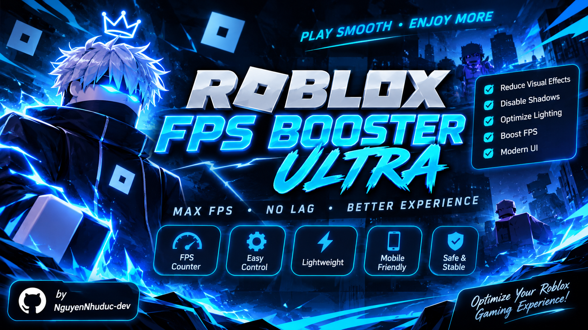

# ⚡ Roblox FPS Booster Ultra & Blox Fruits Gray Map

<p align="center">
  
</p>
<p align="center">
  <strong>Client-side Luau visual optimization tools for Roblox</strong><br>
  General FPS optimization · Blox Fruits grayscale map
</p>

<p align="center">
  
  
  
</p>

---

## 📌 About

This repository contains client-side Luau scripts that adjust visual effects in Roblox experiences. The scripts are separate: choose the one that matches what you want to change.

## 📦 Scripts

### 1. Roblox FPS Booster Ultra — `roblox.lua`

A general-purpose visual optimization script.

**Features**
- Disables selected particle, trail, beam, smoke, fire, and sparkle effects.
- Adjusts selected Lighting and post-processing effects.
- Reduces selected shadow and terrain water visual settings.
- Includes a draggable GUI, approximate FPS display, and restore controls.

**Delta loader**
```lua
loadstring(game:HttpGet(
    "https://raw.githubusercontent.com/nguyennhuduc-dev/robloxscr/refs/heads/main/roblox.lua"
))()
```

**File:** [roblox.lua](roblox.lua)

### 2. Blox Fruits Gray Map Ultra — `blox-fruits-gray-map.lua`

A Blox Fruits-focused map recoloring script. It attempts to turn accessible map parts and terrain material colors gray while leaving water-colored objects and Terrain Water unchanged.

**Features**
- Recolors eligible map BaseParts to gray.
- Hides eligible Decal and Texture instances.
- Changes Terrain material colors except Water.
- Skips character models, NPC models with Humanoids, Tools, and Accessories.
- Watches newly added Workspace objects while enabled.
- Includes a GUI to restore saved colors/materials or re-enable grayscale.

**Delta loader**
```lua
loadstring(game:HttpGet(
    "https://raw.githubusercontent.com/nguyennhuduc-dev/robloxscr/refs/heads/main/blox-fruits-gray-map.lua"
))()
```

**File:** [blox-fruits-gray-map.lua](blox-fruits-gray-map.lua)

> The sea is preserved by skipping Terrain Water and objects detected as water by material or name. Some Blox Fruits water and map assets may use custom meshes, textures, or naming, so perfect separation cannot be guaranteed.

## 🚀 How to use

1. Join the Roblox experience.
2. Open your supported executor (for example, Delta).
3. Paste the loader for the script you want to run.
4. Execute it and use the on-screen controls.
5. Use the restore option before closing when you want to return saved visual properties.

## ⚠️ Notes & limitations

- These scripts make **client-side visual changes**. They do not modify server data, player stats, combat logic, or game progression.
- They do not guarantee higher FPS; results depend on the device, experience, and rendering workload.
- Some visual effects or map objects may be recreated by the game or may not be accessible to the script.
- Restore features can only restore properties that were successfully recorded. If the game changes an object while the script is running, the restored appearance may not exactly match the original.
- Disabling or recoloring visuals can make gameplay cues harder to see.
- Compatibility may change after Roblox, game, or executor updates. Test carefully and stop if you encounter issues.

## 📁 Repository structure

```text
robloxscr/
├── README.md
├── roblox.lua
└── blox-fruits-gray-map.lua
```

## 👨‍💻 Developer

**GitHub:** [@nguyennhuduc-dev](https://github.com/nguyennhuduc-dev)

**Repository:** [nguyennhuduc-dev/robloxscr](https://github.com/nguyennhuduc-dev/robloxscr)

---

<p align="center">
  Made with ❤️ for the Roblox scripting community
</p>
