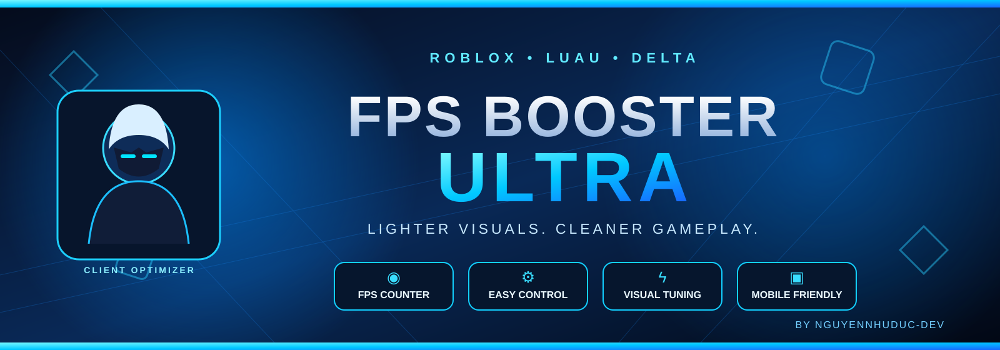

# ⚡ Roblox FPS Booster Ultra

<p align="center">
  
</p>
<p align="center">
  <strong>A lightweight client-side visual optimization script for Roblox</strong><br>
  Built with Luau · Designed for general Roblox experiences
</p>

<p align="center">
  
  
  
  
</p>

---

## 📌 About

**Roblox FPS Booster Ultra** is a client-side Luau script that reduces selected visual effects in a Roblox experience. It includes a compact control panel, an animated startup screen, and a live FPS display.

The script is intended for general use. Actual performance improvements depend on the device, the Roblox experience, and its rendering workload. It does not unlock FPS beyond the device or client limit, and it cannot guarantee a specific FPS.

## ✨ Features

| Feature | Description |
| --- | --- |
| ⚡ Visual optimization | Disables selected particles, trails, beams, smoke, fire, and sparkles |
| 💡 Lighting optimization | Turns off selected post-processing and shadow effects |
| 🌊 Terrain adjustment | Reduces water wave and reflection effects |
| 📊 FPS display | Shows an approximate live client FPS reading |
| 🎨 Intro animation | Displays a short animated initialization screen |
| 🖱️ Draggable interface | Move the control panel using its title area |
| ♻️ Restore settings | Attempts to restore properties changed by the script |
| 🧹 Cleanup | Stops tracked connections and removes the interface |

## 🚀 Run with Delta

Run this loader in your supported Roblox executor:

```lua
loadstring(game:HttpGet(
    "https://raw.githubusercontent.com/nguyennhuduc-dev/robloxscr/refs/heads/main/roblox.lua"
))()
```

> Only run scripts you have reviewed and trust. Avoid executing code from unknown sources.

## 🎮 How to use

1. Execute the loader after joining a Roblox experience.
2. Wait for the intro screen to finish.
3. Drag the panel by its title area if you want to reposition it.
4. Select **ENABLE BOOST** to apply the visual changes.
5. Select **DISABLE BOOST** or **RESTORE SETTINGS** to stop the optimization and restore saved properties.
6. Select **CLOSE GUI** to clean up the interface and tracked connections.

## ⚙️ What it changes

The script targets selected client-visible properties, including:

- Particle emitters, trails, beams, smoke, fire, and sparkles.
- Post-processing effects under Lighting.
- Part and light shadow settings.
- Lighting global shadows and fog distance.
- Terrain water wave and reflectance settings.

It also watches for newly added Workspace and Lighting descendants while the boost is enabled.

## ⚠️ Notes & limitations

- This is a **client-side visual optimization**, not a server-side performance tool.
- Some games rely on particles, lighting, or visual effects to communicate gameplay information. Disabling them may make parts of a game harder to see or understand.
- The FPS number is an approximate measurement based on rendered frames.
- The restore feature can only restore properties the script successfully recorded; game scripts may also change those properties while you play.
- Compatibility may vary across Roblox updates, experiences, devices, and executors.
- No FPS increase is guaranteed. Test the script in a suitable experience and stop using it if it causes problems.

## 📁 Repository

```text
robloxscr/
├── README.md
└── roblox.lua
```

## 👨‍💻 Developer

**GitHub:** [@nguyennhuduc-dev](https://github.com/nguyennhuduc-dev)

**Repository:** [nguyennhuduc-dev/robloxscr](https://github.com/nguyennhuduc-dev/robloxscr)

---

<p align="center">
  Made with ❤️ for the Roblox scripting community
</p>
